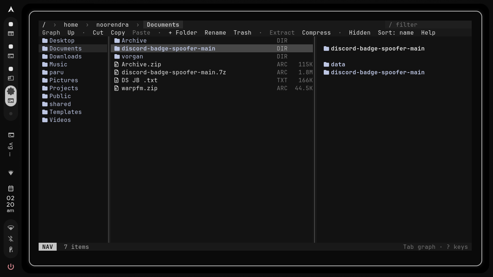
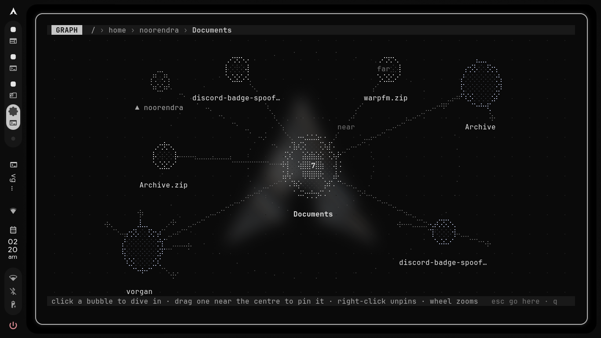

# Vorgan

A mouse-and-keyboard file manager for the terminal. Its signature move is the
**Graph** (press `Tab`): your current folder, its folders and its archives as
bubbles you click through like Obsidian's graph view, with a physics layout,
pinning and zoom.



The Graph:



Made on Arch + Hyprland + fish with the Caelestia palette, but it runs in any
terminal with mouse support, and it reads its colours live from whatever rice
you point it at.

## Install

### Arch + fish

```bash
git clone https://github.com/exotic-erox/vorgan
cd vorgan
./install.sh
```

That's the whole tutorial — `install.sh` is safe to run again any time to
update. It asks pacman for `libarchive` (archive folders) and `pipx` if they
are missing, installs the package, and copies the `vg` launcher into
`~/.config/fish/functions`. Prefer doing it by hand:

```bash
sudo pacman -S --needed libarchive python-pipx
pipx install --force .
mkdir -p ~/.config/fish/functions
cp shell/vg.fish ~/.config/fish/functions/vg.fish
```

Open a new fish shell and run `vg`. `q` quits and drops the shell into the
folder you ended in; `Q` quits and stays put.

### Any other distro, any shell (bash, zsh, …)

1. System bits — install `pipx` and `bsdtar`, the binary that reads archives:
   - Debian / Ubuntu: `sudo apt install pipx libarchive-tools`
   - Fedora: `sudo dnf install pipx bsdtar`
   - Arch without fish: `sudo pacman -S --needed python-pipx libarchive`
   - Older Debian without a `pipx` package: `python3 -m pip install --user pipx`
2. Make pipx visible to your shell: `pipx ensurepath`, then open a fresh shell.
3. Clone and install:

   ```bash
   git clone https://github.com/exotic-erox/vorgan
   cd vorgan
   pipx install .
   ```

4. Run it: `vorgan ~/Documents`, or `vorgan` inside a folder.
5. Quit-and-cd is fish's `vg` by default; give bash/zsh the same with the
   snippet in the next section. Fish users only need the launcher file:
   `cp shell/vg.fish ~/.config/fish/functions/`.

### Quit and cd on other shells (bash / zsh)

The fish launcher hands the folder you ended in back to your shell. Same trick
for bash/zsh — put this in your `~/.bashrc` or `~/.zshrc`:

```bash
vorgan() {
    local tmp="$(mktemp)"
    command vorgan --cwd-file="$tmp" "$@"
    if [ -s "$tmp" ]; then
        local dir; read -r dir < "$tmp"
        [ -d "$dir" ] && [ "$dir" != "$PWD" ] && cd "$dir"
    fi
    command rm -f -- "$tmp"
}
```

Fish users already have it: the `vg` function does exactly this.

## Files, the Graph and everything else

Everything works with the mouse (click, double-click, ctrl/shift click,
drag onto a folder to move, right-click menus, toolbar) and with the keyboard.
The full keybind list lives in [docs/KEYBINDS.md](docs/KEYBINDS.md); this is
the daily bread:

| Key | Action |
|---|---|
| `j k h l` / arrows | Move, open, up |
| `f` | Hint tags: type the tag to jump to any visible item |
| `m` + letter, `'` + letter | Pin the current folder, jump back to it |
| `/` | Live filter, `.` hidden files, `s` sort |
| `space`, `ctrl+a` | Select |
| `y x p` | Copy, cut, paste |
| `r`, `a`, `A`, `d`, `D` | Rename, new folder, new file, trash, delete forever |
| `e`, `z` | Extract (here or to a path), compress (name, format, path, optional zip password) |
| `~` | Frequent folders from your fish history |
| drag a pane edge | Resize the three panes (remembered across runs) |
| `t` | Open a terminal here |
| `q` / `Q` | Quit and cd / quit |

### The Graph (Tab)

| Do this | What happens |
|---|---|
| Click a bubble | Dive into that folder. The graph re-centres and shows its folders. |
| Click the centre bubble | Close the graph and go to that folder. |
| Click the dim up-arrow bubble | Go up one level. |
| Drag a bubble close to the centre | Pin it there (gold dotted ring). Pins are remembered. |
| Right-click a pinned bubble | Unpin it. |
| Mouse wheel / `+` `-` | Zoom. |
| Hover a bubble | Highlights its links, shows the names of its folders. |
| `+N more` bubble | Next page when a folder has many subfolders. |

Zip, tar, 7z and other archives show up as purple bubbles you can dive into
like folders.

## Configuration

`~/.config/vorgan/config.toml` (optional):

```toml
icons = "nerd"          # or "plain" if your font has no Nerd glyphs
show_hidden = false
sort = "name"           # name | size | date | type
archive_format = "zip"  # zip | tar.gz | tar.zst | tar.xz | 7z
graph_max_nodes = 28

[keys]
graph = "g"             # remap any action; see docs/KEYBINDS.md for all names
```

## Files it uses

| Path | Purpose |
|---|---|
| `~/.config/vorgan/config.toml` | Settings and key remaps (optional) |
| `~/.local/state/vorgan/` | Graph pins, letter anchors, pane widths |
| `~/.local/state/caelestia/scheme.json` | Read-only: colours, re-read live (see docs/THEME.md) |

No scheme file means the built-in dark palette.

## Requirements

Python 3.11+, `libarchive` (bsdtar), a terminal with mouse support (foot is
what it is developed against), a Nerd Font for icons (`icons = "plain"` otherwise).
Optional: `wl-clipboard` (copy path), `xdg-utils` (open files), `glib2` (`gio trash`).

## Development

```
python -m venv .venv && . .venv/bin/activate
pip install -e '.[dev]'
pytest
```

More docs: [ARCHITECTURE](docs/ARCHITECTURE.md) · [KEYBINDS](docs/KEYBINDS.md) ·
[THEME](docs/THEME.md) · [WORKFLOW](docs/WORKFLOW.md) · [ROADMAP](docs/ROADMAP.md)

## License

MIT — see [LICENSE](LICENSE).

## Social

[](https://pypi.org/project/vizr/)
[](https://github.com/exotic-erox/vizr)
[](https://discord.com/users/1515183303995560096)
